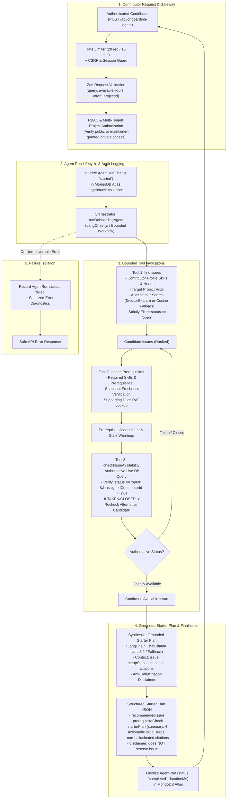

# Purposeful AI-Powered Onboarding Agent Architecture

This document details the architectural design, bounded tool mechanics, orchestration workflow, safety boundaries, and anti-hallucination controls for the **Purposeful AI-Powered Onboarding Agent** in the Open Source Contributor Onboarding backend.

---

## 1. System Overview & Core Philosophy

The Onboarding Agent is an autonomous, purposeful AI assistant designed to guide student developers into open-source projects without friction, confusion, or unrealistic expectations.

Unlike unconstrained chat bots or free-form code writers, this agent operates within **strict, auditable, and bounded software boundaries**:
1. **Bounded Tools Only**: The agent cannot run shell commands, alter project files, assign issues, or approve contribution plans. It has access exclusively to three explicit read-only inspection tools: `findIssues`, `inspectPrerequisites`, and `checkIssueAvailability`.
2. **Authoritative Ground Truth**: The agent never trusts its own memory or LLM weights for issue availability or setup steps. It authoritatively queries MongoDB and repository documentation snapshots.
3. **No Phantom Tasks & Zero Hallucination**: Issues, required skills, and setup commands are grounded in stored metadata and repository snapshots.
4. **Availability Double-Check**: Even if an issue was matched during discovery, the agent executes an authoritative real-time check (`checkIssueAvailability`) before generating a starter plan. If the top candidate is claimed (`status: taken` or `status: closed`), the agent automatically evaluates the next candidate.
5. **No Auto-Assignment or Pre-Approval**: The agent generates a structured starter plan for the contributor, but it **never** automatically creates or approves a `ContributionPlan` document in the database. Formal contribution still requires the student to submit a plan and obtain human maintainer review.
6. **Auditability**: Every agent execution is persisted to the `agentruns` collection with structured tool calls, timestamps, inputs, outputs, duration, and status (`started`, `completed`, `failed`).

---

## 2. Agent Architecture Diagram

---

## 3. Bounded Tool Specifications

### 3.1 Tool 1: `findIssues`
* **File**: `src/agent/tools/findIssues.tool.js`
* **Purpose**: Discovers open issues tailored to the contributor's declared programming skills, available hours, and target effort timeframe.
* **Input Schema (`findIssuesInputSchema`)**:
  * `skills` (`string[]`, optional): Contributor programming languages or tools.
  * `projectId` (`ObjectId string`, optional): Scopes discovery to a specific project.
  * `availableHours` (`number`, min 1, max 168, optional): Available hours (e.g. 10 for a weekend).
  * `effort` (`enum: hours | weekend | few_days | week_plus`, optional): Desired task duration.
  * `interests` (`string[]`, optional): Focus topics (e.g. `['testing', 'docs']`).
  * `query` (`string`, max 500 chars, optional): Natural language intent (e.g. `"Find a task I can start this weekend"`).
  * `limit` (`number`, 1–10, default: 5).
* **Guarantees**:
  * Enforces project-level multi-tenant boundaries (rejects private projects if contributor has no maintainer grant).
  * Strictly queries `status: 'open'`—taken or closed issues are never returned.
  * Employs hybrid discovery: attempts 768-dimensional Atlas Vector Search (`issue_vector_index`) or in-memory cosine fallback; falls back to deterministic skill/effort/interest scoring if embeddings are unavailable.
  * Populates explicit `matchReasons` and identifies `skillGaps`.

### 3.2 Tool 2: `inspectPrerequisites`
* **File**: `src/agent/tools/inspectPrerequisites.tool.js`
* **Purpose**: Thoroughly inspects local setup steps, required skills, and supporting documentation references for a target issue.
* **Input Schema (`inspectPrerequisitesInputSchema`)**:
  * `issueId` (`ObjectId string`, required): Target issue identifier.
* **Guarantees**:
  * Evaluates contributor skill overlap and pinpoints learning requirements.
  * Inspects project snapshot freshness (`isStale: true` / `staleReason`). If documentation or setup notes are outdated, attaches explicit warnings without hallucinating missing instructions.
  * Retrieves relevant markdown chunk references from the snapshot documentation.

### 3.3 Tool 3: `checkIssueAvailability`
* **File**: `src/agent/tools/checkIssueAvailability.tool.js`
* **Purpose**: Authoritatively checks database state to ensure the issue is currently unassigned and open.
* **Input Schema (`checkIssueAvailabilityInputSchema`)**:
  * `issueId` (`ObjectId string`, required): Target issue identifier.
* **Guarantees**:
  * Real-time authoritative query against MongoDB `Issue` collection.
  * Returns `{ isAvailable: true, status: 'open' }` only if `status === 'open'` and `assignedContributorId === null`.
  * Returns `{ isAvailable: false, reason: 'Issue is already assigned to a contributor' }` if taken.
  * **Zero Side-Effects**: Read-only check; does not mutate status or assign the contributor.
  * Includes standard disclaimer: `Authoritative check confirms issue status as open. This check does NOT reserve or lock the issue.`

---

## 4. Primary Scenario: *"Find a task I can start this weekend"*

When a student submits the natural-language query *"Find a task I can start this weekend"*:
1. **Normalization**: The agent identifies effort constraint as `'weekend'` (or maps contributor's weekly available hours, e.g. 10–15 hours).
2. **Issue Matching**: `findIssues` discovers candidate tasks tagged with `estimatedEffort: 'weekend'` or `'hours'` matching the student's registered skills (e.g. `javascript`, `react`).
3. **Deep Inspection**: `inspectPrerequisites` verifies prerequisites (e.g. Node 20+, Docker) and checks snapshot freshness.
4. **Availability Verification**: `checkIssueAvailability` verifies that the issue has not been claimed since the snapshot import.
5. **Alternative Candidate Switching**: If the top-scoring candidate has been claimed by another student, the agent does not halt; it proceeds to candidate #2, performs the availability check, and selects the alternative.
6. **Starter Plan Generation**: Synthesizes a practical starter plan with 4 concrete initial steps:
   - Step 1: Environment & Tooling Verification
   - Step 2: Codebase Exploration & Target File Inspection
   - Step 3: Minimal Reproduction or Baseline Test Run
   - Step 4: Drafting Formal Contribution Plan for Maintainer Review

---

## 5. Security & Safety Guardrails

| Guardrail | Enforcement Mechanism |
|---|---|
| **Role-Based Access Control (RBAC)** | Requires authenticated session (`requireAuth`). Open to all valid contributors, maintainers, and moderators. |
| **Project Boundary Isolation** | Contributor cannot query or receive issues from private projects unless holding a valid `MaintainerGrant`. Platform moderators cannot access private projects without explicit project grants. |
| **CSRF & Rate Limiting** | Protected by synchronizer CSRF tokens (`csrfProtection`) and dedicated rate limiting (`agentRateLimiter`: 20 requests per 15 minutes per IP/session). |
| **Strict Tool Sandbox** | The LangChain agent is given only bounded tools. It cannot execute bash, evaluate code, or mutate database collections. |
| **No Auto-Assignment** | The agent never sets `assignedContributorId` or changes `Issue.status` to `taken`. |
| **No Auto-Approval** | The agent never invokes `ContributionPlan.create()` or sets `status: 'approved'`. |
| **Untrusted Content Safety** | Markdown descriptions and repo guides are treated strictly as passive text data. |
| **Diagnostic Sanitization** | `AgentRun` logs preserve debugging information while redacting passwords, session tokens, and raw credentials. |

---

## 6. Local AI Stack & Offline Determinism

* **Orchestration**: LangChain.js (`@langchain/core/tools`, `@langchain/community/chat_models/ollama`).
* **Embeddings**: Local Ollama `nomic-embed-text` (768 dimensions).
* **Generation**: Local Ollama `llama3.2` with low temperature (`0.1`) for strict factual adherence.
* **Offline Resilience**:
  * When Ollama is offline or unconfigured, `issue.service.js` and `onboardingAgent.js` use structured deterministic synthesis and in-memory cosine similarity fallback.
  * Unit tests run 100% deterministically in zero-network environments without requiring a running Ollama daemon or MongoDB Atlas cluster.
