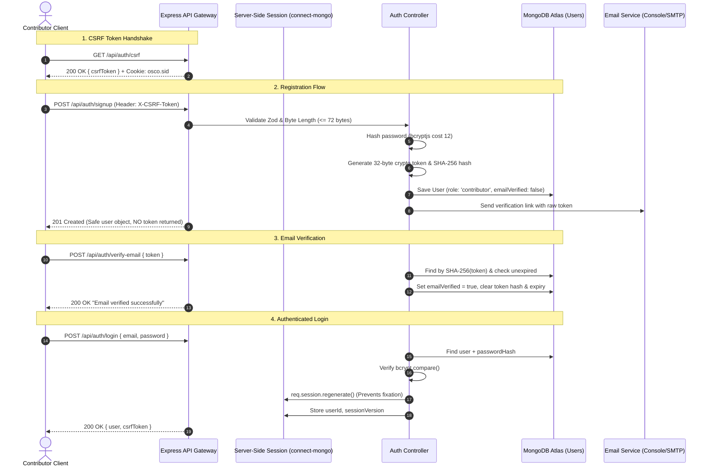
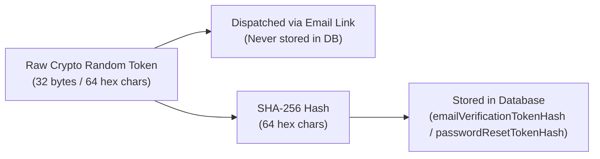

# Authentication and Security Architecture

**Capstone Project 12**: Open Source Contributor Onboarding  
**Current Milestone**: Phase 3 (Authentication, Session Management, CSRF & RBAC)  
**Security Framework**: Express Session, connect-mongo, csrf-sync, bcryptjs, express-rate-limit

---

## 1. Architecture Overview

Phase 3 introduces an enterprise-grade, defense-in-depth authentication and authorization foundation tailored for student onboarding while strictly preventing privilege escalation and account hijacking.



---

## 2. Password Security

### 2.1 Algorithm & Cost Factor
* **Library**: `bcryptjs` (asynchronous execution).
* **Cost Factor (Salt Rounds)**: Configured via `env.BCRYPT_SALT_ROUNDS` (default: `12`).
* **Input-Length Guard**: The Bcrypt algorithm truncates input at **72 bytes**. Passwords exceeding 72 bytes can suffer from truncation attacks (e.g. `secretpassword...` and `secretpassword...extra` matching the same hash). Our `validatePasswordStrength()` explicitly computes `Buffer.byteLength(password, 'utf8')` and rejects inputs exceeding 72 bytes before hashing.
* **Storage**: Passwords are never stored in plaintext and never logged. The `passwordHash` field in `User.js` has `{ select: false }` so queries omit it unless explicitly requested via `.select('+passwordHash')`.

---

## 3. Cryptographic Token Architecture

Verification tokens and password-reset tokens use a **dual-token design** to prevent token theft in the event of database leaks:



1. **Generation**: Generated using Node.js native `crypto.randomBytes(32).toString('hex')`.
2. **Storage**: Only the **SHA-256 hash** (`crypto.createHash('sha256').update(rawToken).digest('hex')`) is stored in MongoDB Atlas with a strict timestamp expiry:
   * **Email Verification**: 24 hours (`Date.now() + 24 * 60 * 60 * 1000`).
   * **Password Reset**: 1 hour (`Date.now() + 60 * 60 * 1000`).
3. **Verification**: When the client submits the token, the backend hashes the incoming token and queries MongoDB by `hashedToken` where `expiresAt > new Date()`.
4. **Single-Use Enforcement**: Upon consumption, the token hash and expiry fields are unset (`$unset`), preventing replay attacks.
5. **No Exposure**: Tokens are **never** returned in API responses.

---

## 4. Server-Side Session Management

### 4.1 Persistence via `connect-mongo`
* Sessions are persisted in MongoDB Atlas in the `sessions` collection using `connect-mongo`.
* In production, the session store reuses Mongoose's existing client connection (`mongoose.connection.getClient()`), avoiding duplicate database connections.

### 4.2 Cookie Configuration
| Setting | Value | Rationale |
| :--- | :--- | :--- |
| **Name** | `osco.sid` | Distinct identifier for the portal session. |
| **`httpOnly`** | `true` | Prevents client-side scripts from reading the session cookie (XSS protection). |
| **`secure`** | `env.NODE_ENV === 'production'` | Requires HTTPS in production environments. |
| **`sameSite`** | `'lax'` | Protects against CSRF while permitting top-level navigation. |
| **`maxAge`** | `604800000` (7 days) | Configurable via `env.SESSION_MAX_AGE_MS`. |

### 4.3 Session Fixation & Revocation
* **Regeneration**: Upon successful login, `req.session.regenerate()` assigns a completely new session ID.
* **Global Invalidation on Password Reset**: The `User` model maintains `sessionVersion: Number` (default: `1`). When a password reset occurs, `sessionVersion` is incremented. `requireAuth` verifies that `req.session.sessionVersion === user.sessionVersion`. Any active session with an outdated version is instantly destroyed.

---

## 5. CSRF Protection (`csrf-sync`)

State-changing requests (`POST`, `PATCH`, `DELETE`) are guarded using the **Synchronizer Token Pattern** via `csrf-sync`:
1. **Obtaining Token**: The client calls `GET /api/auth/csrf`.
2. **Sending Token**: The client includes the token in the `X-CSRF-Token` request header for subsequent state-changing operations.
3. **Validation**: If `X-CSRF-Token` is missing or does not match `req.session.csrfToken`, the request is rejected with `403 CSRF_INVALID`.
4. **Public GET Exemption**: Read-only endpoints (`GET /api/health`, `GET /api/projects`) are exempt from CSRF validation.

---

## 6. Role-Based Access Control (RBAC) & Project Grants

### 6.1 Role Hierarchy
* **`contributor`**: Default role for all public registrations. Cannot self-assign staff roles.
* **`maintainer`**: Granted project-level authority via `MaintainerGrant` records.
* **`moderator`**: Platform staff verifying projects (`PATCH /api/projects/:id/verification`).

### 6.2 Project-Scoped Authority Boundary
> [!IMPORTANT]
> A maintainer does **not** have global admin rights across all projects. Maintainer actions (e.g. reviewing plans, importing snapshots) are protected by `requireProjectMaintainer`, which requires an active `MaintainerGrant` scoped specifically to `projectId`.
> 
> Furthermore, platform moderators **cannot** approve code contribution plans unless they hold a project maintainer grant.

---

## 7. Rate Limiting Policy

Configured using `express-rate-limit` with standardized `429 TOO_MANY_REQUESTS` JSON responses:

| Endpoint | Window | Max Requests | Purpose |
| :--- | :--- | :--- | :--- |
| `POST /api/auth/login` | 15 minutes | 5 | Prevents credential brute-forcing. |
| `POST /api/auth/signup` | 60 minutes | 5 | Prevents automated spam registrations. |
| `POST /api/auth/forgot-password` | 15 minutes | 3 | Prevents outbound email abuse. |
| `POST /api/auth/verify-email` | 15 minutes | 10 | Prevents token guessing attacks. |
| `POST /api/auth/reset-password` | 15 minutes | 5 | Prevents brute-forcing recovery tokens. |

---

## 8. Safe Fallback When Database is Unavailable

In development, the Express server boots and serves `GET /api/health` even if `MONGODB_URI` is unconfigured.

However, **authentication operations strictly require a persistent database**. When MongoDB Atlas is not connected:
* All database-backed auth endpoints (`/api/auth/signup`, `/api/auth/login`, `/api/auth/me`, etc.) safely return:
  ```json
  {
    "success": false,
    "error": {
      "code": "DATABASE_UNAVAILABLE",
      "message": "Authentication service is unavailable because MongoDB Atlas is not connected."
    }
  }
  ```
* The server **never** uses an insecure in-memory store to fake database persistence.
