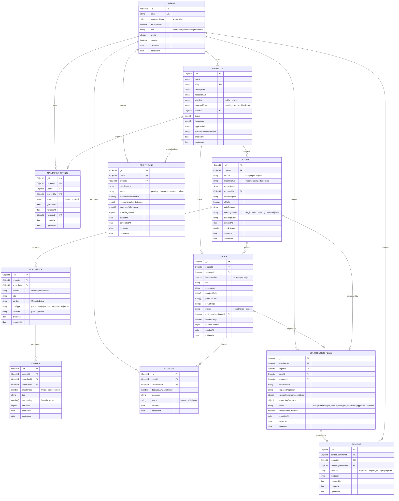

# Database Schema and Data Layer Architecture

**Capstone Project 12**: Open Source Contributor Onboarding  
**Database System**: MongoDB Atlas & Mongoose ODM  
**Milestone**: Phase 2 (Database Schemas and Data Layer)

---

## 1. Overview and Design Principles

The database design provides a modular, reliable, and secure foundation for student onboarding to open-source software. It reflects several key architectural decisions:
1. **Separation of Project Approval and Visibility**: A project can be approved by moderators while remaining `private` (restricted to permitted members) or made `public` for general discovery.
2. **Untrusted Content Isolation**: Imported documentation (e.g. `README.md`, setup guides) is stored strictly as untrusted content; the server and agent never execute or interpret commands found in documentation text.
3. **No Self-Assigned Roles**: The `User` schema enforces default role `'contributor'`. `MaintainerGrant` records are project-scoped and granted by moderators or project owners, never self-assigned.
4. **Session Storage Decoupling**: In Phase 3, server-side sessions will be stored via `connect-mongo` directly in MongoDB's `sessions` collection. To prevent schema collisions with `connect-mongo`'s internal structure, no redundant Mongoose model is introduced.
5. **Deterministic RAG & Agent Grounding**: `Snapshot`, `Document`, and `Chunk` models maintain explicit version references (`v1.0.0`). The `Chunk` model prepares a 768-dimensional embedding vector matching the local `nomic-embed-text` model.

---

## 2. Entity-Relationship (ER) Diagram



---

## 3. Detailed Model Specifications

### 3.1 User (`src/models/User.js`)
* **Purpose**: Manages authenticated contributors, maintainers, and platform moderators.
* **Sensitive Field Protection**: `passwordHash`, `emailVerificationTokenHash`, and `passwordResetTokenHash` are marked `{ select: false }` to prevent accidental exposure in queries.
* **Role Hierarchy**: Valid roles are `contributor`, `maintainer`, and `moderator`. Public signups default strictly to `contributor`.
* **Indexes**:
  * `{ email: 1 }` (unique, lowercase, trimmed).

### 3.2 Project (`src/models/Project.js`)
* **Purpose**: Core entity representing registered open-source projects.
* **Approval vs. Visibility**:
  * `approvalStatus`: Moderation state (`pending`, `approved`, `rejected`).
  * `visibility`: Data exposure state (`public`, `private`).
  * An approved private project is not listed in public discovery (`GET /api/projects`).
* **Indexes**:
  * `{ slug: 1 }` (unique).
  * `{ approvalStatus: 1, visibility: 1 }` (compound index powering public browsing).
  * `{ ownerId: 1 }`.

### 3.3 MaintainerGrant (`src/models/MaintainerGrant.js`)
* **Purpose**: Scopes maintainer authority to specific projects.
* **Security Guardrail**: Maintainers do not have global administrative privileges; their authority is limited strictly to projects where they hold an active `MaintainerGrant`.
* **Indexes**:
  * `{ projectId: 1, userId: 1 }` (unique compound index preventing duplicate grants).
  * `{ projectId: 1, status: 1 }` (fast lookup of active project maintainers).

### 3.4 Snapshot (`src/models/Snapshot.js`)
* **Purpose**: Versioned container for repository documentation and curated issues.
* **Staleness Tracking**: When repository documentation changes or issues fall out of date, maintainers mark `isStale: true` and record `staleReason`.
* **RAG Vector Search Lifecycle (Phase 5)**:
  * `indexingStatus`: Tracks RAG vector indexing state (`not_indexed`, `indexing`, `indexed`, `failed`).
  * `indexingError`: Stores error diagnostics if embedding or ingestion fails.
  * `indexedAt`: Timestamp when vector indexing completed.
  * `chunksCount`: Total number of chunk vectors generated and indexed in MongoDB Atlas.
* **Indexes**:
  * `{ projectId: 1, version: 1 }` (unique compound index ensuring distinct versions).
  * `{ projectId: 1, isStale: 1, importStatus: 1 }`.
  * `{ projectId: 1, indexingStatus: 1 }`.

### 3.5 Document (`src/models/Document.js`)
* **Purpose**: Represents parsed files from a repository snapshot (e.g. `README.md`, `SETUP.md`).
* **Untrusted Content Policy**: Stored markdown is treated as untrusted text. It is never executed in a shell or interpreted as permission-elevating commands.
* **Indexes**:
  * `{ snapshotId: 1, filePath: 1 }` (unique compound index per snapshot).
  * `{ projectId: 1, docType: 1, visibility: 1 }`.

### 3.6 Chunk (`src/models/Chunk.js`)
* **Purpose**: Documentation split into discrete text segments for semantic vector search and RAG Q&A.
* **Vector Configuration**:
  * `embedding`: Validates 768 numeric dimensions (matching Ollama `nomic-embed-text`).
  * `metadata`: Preserves `filePath`, `sectionTitle`, `startLine`, `endLine`, `docType`, and `charCount`.
* **Atlas Vector Search**: Target collection for the `vector_index` search index using cosine similarity and pre-filters on `projectId` and `snapshotId`.
* **Indexes**:
  * `{ documentId: 1, chunkIndex: 1 }` (unique compound index enforcing sequential chunk ordering).
  * `{ snapshotId: 1, chunkIndex: 1 }` (fast sequential retrieval per snapshot).
  * `{ projectId: 1, snapshotId: 1 }` (fast query pre-filtering).

### 3.7 Issue (`src/models/Issue.js`)
* **Purpose**: Curated onboarding tasks and issues.
* **Prerequisites & Availability**: Explicitly tracks `requiredSkills`, `prerequisites`, `setupSteps`, and `status` (`open`, `taken`, `closed`).
* **Anti-Hallucination**: The model does not label issues as "easy"; matching is based on documented skills and available hours.
* **Semantic Vector Search (Phase 6)**:
  * `embedding`: Optional 768-dimensional numeric vector matching Ollama `nomic-embed-text` embeddings generated from composite issue metadata (title, description, required skills, labels, prerequisites, effort).
  * Validates exact dimension length (768) and finite numbers.
* **Indexes**:
  * `{ projectId: 1, issueNumber: 1 }` (unique compound index per project).
  * `{ projectId: 1, status: 1 }` (fast filtering of available open issues).
  * MongoDB Atlas Vector Index: `issue_vector_index` defined on collection `issues` with path `embedding` (768-dim, cosine similarity) and pre-filters `projectId`, `status`.

### 3.8 Interest (`src/models/Interest.js`)
* **Purpose**: Records a contributor’s declared interest and available weekly hours for an issue.
* **Duplicate Prevention**: A partial unique index ensures a contributor cannot submit duplicate active interest records on the same issue.
* **Indexes**:
  * `{ issueId: 1, contributorId: 1 }` (unique with partial filter: `{ status: 'active' }`).

### 3.9 ContributionPlan (`src/models/ContributionPlan.js`)
* **Purpose**: Structured implementation plan submitted by a contributor before writing code.
* **States**: `draft` -> `submitted` -> `in_review` -> `changes_requested` / `approved` / `rejected`.
* **Evidence Grounding**: Must cite specific repository files and snapshot versions.
* **Indexes**:
  * `{ contributorId: 1, status: 1 }` (contributor dashboard).
  * `{ projectId: 1, status: 1 }` (maintainer review inbox).
  * `{ issueId: 1 }`.

### 3.10 Review (`src/models/Review.js`)
* **Purpose**: Maintainer decisions (`approved`, `request_changes`, `rejected`) and constructive feedback on contribution plans.
* **Access Boundary**: Only verified project maintainers may author reviews. Platform moderators cannot approve code contribution plans.
* **Indexes**:
  * `{ contributionPlanId: 1, reviewedAt: -1 }`.

### 3.11 AgentRun (`src/models/AgentRun.js`)
* **Purpose**: Audit logging, diagnostics, and execution tracing for the onboarding agent (`POST /api/onboarding-agent`).
* **Execution Tracking**:
  * `agentType`: Agent discriminator (defaults to `'onboarding'`).
  * `status`: Execution state (`started`, `running`, `completed`, `failed`).
  * `toolCalls`: Array of structured tool invocation logs recording `toolName` (`findIssues`, `inspectPrerequisites`, `checkIssueAvailability`), `inputPayload`, `outputPayload`, `status`, `durationMs`, and `executedAt`.
  * `inputs`: Normalized contributor request payload (`query`, `availableHours`, `effort`, `projectId`).
  * `outputs`: Grounded response payload containing `recommendationFound`, `recommendedIssue`, `starterPlan`, `disclaimer`, and non-hallucinated citations.
  * `errorMessage`: Sanitized error diagnostic string (never exposes secrets or system paths).
* **Safety Rules**: Logs tool calls, inputs, outputs, and reasoning steps without recording secrets or session tokens.
* **Indexes**:
  * `{ userId: 1, createdAt: -1 }`.
  * `{ status: 1 }`.

---

## 4. Session Storage Design

Server-side sessions are implemented using `express-session` combined with `connect-mongo`.

* `connect-mongo` manages its own internal MongoDB collection named `sessions`.
* It handles session serialization, TTL (Time-To-Live) indexing, and automatic cleanup of expired sessions.
* **Design Decision**: We intentionally do not create a redundant Mongoose `Session` model. Introducing an application-level Mongoose model for `sessions` would conflict with `connect-mongo`'s internal schema and driver operations. Authentication controllers rely directly on `req.session`.

---

## 5. MongoDB Atlas Vector Search Index Configuration

### 5.1 Repository Documentation Chunks Index (`vector_index`)
Created on the `chunks` collection for Phase 5 documentation RAG:
```json
{
  "fields": [
    {
      "type": "vector",
      "path": "embedding",
      "numDimensions": 768,
      "similarity": "cosine"
    },
    {
      "type": "filter",
      "path": "projectId"
    },
    {
      "type": "filter",
      "path": "snapshotId"
    }
  ]
}
```
* **Index Name**: `vector_index`
* **Collection**: `chunks`
* **Path**: `embedding`
* **Dimensions**: `768` (matching `nomic-embed-text`)
* **Similarity Metric**: `cosine`
* **Filter Paths**: `projectId` and `snapshotId` (enables pre-filtering vectors strictly to permitted and current snapshots, preventing private-project data leakage).

### 5.2 Curated Issues Index (`issue_vector_index`)
Created on the `issues` collection for Phase 6 Onboarding Agent task matching:
```json
{
  "fields": [
    {
      "type": "vector",
      "path": "embedding",
      "numDimensions": 768,
      "similarity": "cosine"
    },
    {
      "type": "filter",
      "path": "projectId"
    },
    {
      "type": "filter",
      "path": "status"
    }
  ]
}
```
* **Index Name**: `issue_vector_index`
* **Collection**: `issues`
* **Path**: `embedding`
* **Dimensions**: `768` (matching `nomic-embed-text`)
* **Similarity Metric**: `cosine`
* **Filter Paths**: `projectId` and `status` (enables pre-filtering vectors strictly to permitted projects and `open` issues, preventing closed/taken issues from appearing).
* **CLI Indexer**: `npm run rag:index-issues` parses open issues, constructs composite descriptions, generates 768-dim embeddings via Ollama, and persists them to MongoDB.
