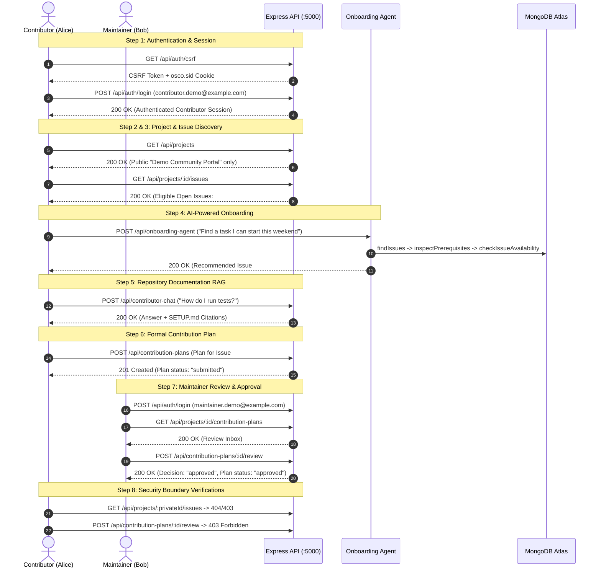

# End-to-End Contributor Demonstration Script

This script provides an interactive, predictable, and reproducible demonstration of the **Open Source Contributor Onboarding** backend for faculty reviewers, evaluators, and project presentations.

---

## 1. Demonstration Overview & User Personas

| Role | Email | Password (Default) | Purpose in Demo |
| :--- | :--- | :--- | :--- |
| **Contributor** | `contributor.demo@example.com` | `DemoPassword123!` | Public project discovery, issue discovery, AI task onboarding, documentation RAG Q&A, contribution plan submission. |
| **Maintainer** | `maintainer.demo@example.com` | `DemoPassword123!` | Review inbox retrieval, formal plan evaluation, and review submission (`approved`). |
| **Moderator** | `moderator.demo@example.com` | `DemoPassword123!` | Platform-level project verification, governance boundary enforcement. |

> [!NOTE]
> Demo passwords can be overridden before seeding by setting `DEMO_PASSWORD` in your environment. Plaintext passwords are never logged or stored in the database.

---

## 2. Pre-Demonstration Setup

```bash
# 1. Install all dependencies
npm install

# 2. Populate the database with reproducible demonstration data
npm run db:seed

# 3. Start the backend server
npm run dev
```

Verify that the server prints:
`🚀 Server running on port 5000 in development mode`<br>
`✅ MongoDB Atlas connected`

---

## 3. Step-by-Step Demonstration Walkthrough



---

### Step 1: Contributor Authentication & CSRF Handshake

```bash
# 1a. Obtain CSRF Token and initialize session cookie
curl -i -c demo_cookies.txt http://localhost:5000/api/auth/csrf

# Extract the "csrfToken" string from response body:
# { "success": true, "data": { "csrfToken": "<CSRF_TOKEN>" } }
```

```bash
# 1b. Log in as demonstration contributor
curl -i -b demo_cookies.txt -c demo_cookies.txt \
  -X POST http://localhost:5000/api/auth/login \
  -H "Content-Type: application/json" \
  -H "X-CSRF-Token: <CSRF_TOKEN>" \
  -d '{
    "email": "contributor.demo@example.com",
    "password": "DemoPassword123!"
  }'
```
**Expected Response:** `200 OK` with contributor profile details.

---

### Step 2: Public Project Discovery

```bash
curl -i -b demo_cookies.txt http://localhost:5000/api/projects
```
**Expected Response:** `200 OK`
* Shows **Demo Community Portal** (`demo-community-portal`, `visibility: "public"`).
* **Demo Enterprise Internal Audit** is strictly hidden from this list because it is marked `visibility: "private"`.

---

### Step 3: Browse Eligible Open Issues

```bash
# Use the Project ID returned in Step 2:
curl -i -b demo_cookies.txt http://localhost:5000/api/projects/<PUBLIC_PROJECT_ID>/issues
```
**Expected Response:** `200 OK`
* Displays only open eligible issues (`status: "open"`).
* Issue #105 (marked `status: "taken"`) and Issue #106 (marked `status: "closed"`) are completely omitted.

---

### Step 4: AI-Powered Onboarding Request (*"Find a task I can start this weekend"*)

```bash
curl -i -b demo_cookies.txt -c demo_cookies.txt \
  -X POST http://localhost:5000/api/onboarding-agent \
  -H "Content-Type: application/json" \
  -H "X-CSRF-Token: <CSRF_TOKEN>" \
  -d '{
    "query": "Find a task I can start this weekend",
    "availableHours": 12,
    "effort": "weekend"
  }'
```
**Expected Response:** `200 OK`
* **Candidate Match:** Selects Issue #101 (*"Implement Responsive Navigation Bar Unit Tests"*).
* **Prerequisites Checked:** Matches Node.js and React skills; verifies `SETUP.md` references.
* **Authoritative Availability Check:** Confirms `isAvailable: true` and `status: "open"`.
* **Actionable Starter Plan:** Provides 4 concrete implementation steps.
* **Non-Reservation Disclaimer:** Explicitly clarifies that the recommendation does not reserve the issue.

---

### Step 5: Contributor Documentation RAG Question

```bash
curl -i -b demo_cookies.txt -c demo_cookies.txt \
  -X POST http://localhost:5000/api/contributor-chat \
  -H "Content-Type: application/json" \
  -H "X-CSRF-Token: <CSRF_TOKEN>" \
  -d '{
    "projectId": "<PUBLIC_PROJECT_ID>",
    "message": "How do I run tests and what Node version is required?"
  }'
```
**Expected Response:** `200 OK`
* Answers that Node.js 20+ is required and `npm test` runs the test suite.
* Non-fabricated citations referencing `SETUP.md` and `README.md`.

---

### Step 6: Contributor Submits Formal Contribution Plan

```bash
curl -i -b demo_cookies.txt -c demo_cookies.txt \
  -X POST http://localhost:5000/api/contribution-plans \
  -H "Content-Type: application/json" \
  -H "X-CSRF-Token: <CSRF_TOKEN>" \
  -d '{
    "projectId": "<PUBLIC_PROJECT_ID>",
    "issueId": "<ISSUE_101_ID>",
    "snapshotId": "<SNAPSHOT_V1_ID>",
    "planObjective": "Implement unit tests for responsive navigation bar.",
    "proposedApproach": "Use Supertest and React component tests across mobile and desktop viewports.",
    "orderedImplementationSteps": [
      {
        "stepNumber": 1,
        "description": "Checkout feature/nav-tests branch and verify local environment.",
        "targetFiles": ["package.json"],
        "estimatedHours": 1
      },
      {
        "stepNumber": 2,
        "description": "Write responsive viewport tests using Supertest.",
        "targetFiles": ["tests/nav.test.js"],
        "estimatedHours": 5
      }
    ],
    "evidenceCitations": [
      {
        "documentPath": "README.md",
        "sectionHeading": "Runtime Requirements",
        "snapshotVersion": "v1.0.0",
        "citationSnippet": "Node.js >= 20.0.0 and npm >= 10.0.0"
      }
    ]
  }'
```
**Expected Response:** `201 Created`
* Creates plan in status `submitted`.
* Note the generated `<PLAN_ID>`.

---

### Step 7: Maintainer Reviews & Approves Contribution Plan

```bash
# 7a. Maintainer Login
curl -i -c maintainer_cookies.txt -b maintainer_cookies.txt \
  -X POST http://localhost:5000/api/auth/login \
  -H "Content-Type: application/json" \
  -H "X-CSRF-Token: <CSRF_TOKEN>" \
  -d '{
    "email": "maintainer.demo@example.com",
    "password": "DemoPassword123!"
  }'
```

```bash
# 7b. Maintainer Views Review Inbox
curl -i -b maintainer_cookies.txt http://localhost:5000/api/projects/<PUBLIC_PROJECT_ID>/contribution-plans
```

```bash
# 7c. Maintainer Approves Plan
curl -i -b maintainer_cookies.txt \
  -X POST http://localhost:5000/api/contribution-plans/<PLAN_ID>/review \
  -H "Content-Type: application/json" \
  -H "X-CSRF-Token: <MAINTAINER_CSRF_TOKEN>" \
  -d '{
    "decision": "approved",
    "feedback": "Comprehensive and well-grounded testing plan. Approved to proceed."
  }'
```
**Expected Response:** `200 OK`
* Creates review record with decision `approved`.
* Plan status updates to `approved`.

---

### Step 8: Security Boundary Verifications

#### 8a. Contributor Attempts to Access Private Project
```bash
curl -i -b demo_cookies.txt http://localhost:5000/api/projects/<PRIVATE_PROJECT_ID>/issues
```
**Expected Response:** `404 Not Found` (Prevents leaking existence of private projects).

#### 8b. Contributor Attempts Self-Review on Contribution Plan
```bash
curl -i -b demo_cookies.txt \
  -X POST http://localhost:5000/api/contribution-plans/<PLAN_ID>/review \
  -H "Content-Type: application/json" \
  -H "X-CSRF-Token: <CSRF_TOKEN>" \
  -d '{
    "decision": "approved",
    "feedback": "I am approving my own plan."
  }'
```
**Expected Response:** `403 Forbidden` (`FORBIDDEN_NOT_MAINTAINER` - Contributors cannot self-review plans).

#### 8c. Request Missing CSRF Token
```bash
curl -i -b demo_cookies.txt \
  -X POST http://localhost:5000/api/onboarding-agent \
  -H "Content-Type: application/json" \
  -d '{ "query": "Find a task" }'
```
**Expected Response:** `403 Forbidden` (`CSRF_INVALID`).
