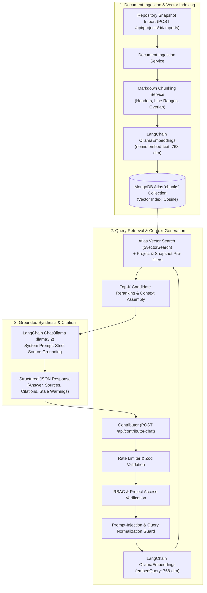

# RAG Architecture & Vector Search Pipeline

This document details the architectural design, ingestion pipeline, vector retrieval mechanics, security guardrails, and generation workflow for the **Repository Retrieval-Augmented Generation (RAG)** system in the Open Source Contributor Onboarding portal.

---

## 1. System Overview & Architecture

The RAG subsystem empowers open-source contributors to query repository documentation (READMEs, CONTRIBUTING guides, architecture docs, coding standards) using natural language. The architecture prioritizes:
1. **Zero Hallucination / Groundedness**: Every answer is strictly grounded in retrieved markdown chunks with explicit file paths and line ranges.
2. **Data Isolation**: Pre-filtered multi-tenant boundaries ensure contributors cannot query documents from other projects or unreleased internal documents.
3. **Local AI Execution**: Uses local Ollama inference models (`llama3.2` and `nomic-embed-text`) with zero reliance on paid commercial APIs.
4. **Resilience**: Graceful fallbacks for local test execution, offline development, and unindexed snapshots.



---

## 2. Ingestion Pipeline & Chunking Strategy

### 2.1 Chunking Mechanics (`src/services/chunking.service.js`)
Markdown documentation is structurally distinct from plain text. The chunker implements a heading-aware strategy:
* **Section Splitting**: Splits on Markdown headers (`#`, `##`, `###`, `####`), preserving hierarchical context (`sectionTitle`).
* **Line Number Tracking**: Accurately tracks `startLine` and `endLine` relative to the original source file.
* **Size & Overlap**:
  * Default maximum chunk length: `800` characters.
  * Overlap boundary: `150` characters across paragraph boundaries to avoid breaking sentence semantics.
* **Code Block Integrity**: Fenced code blocks (` ``` `) are protected from being split mid-block when possible.
* **Metadata Attachment**: Every chunk preserves:
  * `documentId`, `projectId`, `snapshotId`
  * `filePath` (e.g. `docs/CONTRIBUTING.md`)
  * `sectionTitle` (e.g. `## Setting Up Local Environment`)
  * `startLine`, `endLine`
  * `chunkIndex`

---

## 3. Embedding Pipeline (`src/services/embedding.service.js`)

* **Model**: `nomic-embed-text` via `@langchain/ollama`.
* **Dimensionality**: Strictly validated at `768` dimensions.
* **Zero-Vector Rejection**: Verifies vector norm \(\sqrt{\sum v_i^2} > 10^{-6}\) to guard against collapsed embeddings.
* **Batch Processing**: Embedded in controlled batches (default 25 chunks) to prevent memory saturation and Ollama HTTP socket exhaustion.
* **Offline Resilience**: If the Ollama daemon is offline during snapshot creation, snapshots are safely stored with `indexingStatus: "failed"` / `"not_indexed"`, allowing later asynchronous indexing via `npm run rag:index`.

---

## 4. Atlas Vector Search & Pre-Filtering (`src/services/vector-search.service.js`)

Atlas Vector Search executes a `$vectorSearch` aggregation stage:
```javascript
{
  $vectorSearch: {
    index: "vector_index",
    path: "embedding",
    queryVector: queryVector,
    numCandidates: 50,
    limit: 5,
    filter: {
      projectId: targetProjectId,
      snapshotId: targetSnapshotId
    }
  }
}
```

### Pre-Filter vs Post-Filter:
Atlas Vector Search filters candidates **before** vector scoring using Lucene filter indices. This guarantees:
1. Contributors never inspect chunks from other projects.
2. Search space is strictly constrained to the chosen snapshot version.
3. High query performance without vector candidate dilution.

### Local Test Fallback:
If running against a standalone local MongoDB without Atlas Search enabled, the service automatically performs an exact **in-memory cosine similarity fallback**:
$$\text{sim}(\vec{u}, \vec{v}) = \frac{\vec{u} \cdot \vec{v}}{\|\vec{u}\|_2 \|\vec{v}\|_2}$$

---

## 5. Security & Prompt-Injection Guardrails

1. **Prompt Injection Defense (`src/services/rag.service.js`)**:
   * Evaluates queries for jailbreak patterns (`ignore previous instructions`, `system prompt`, `you are now an administrator`, XML/markdown delimiter smuggling).
   * Refuses malicious prompts deterministically before invoking the LLM.
2. **Source Isolation**:
   * Context is passed to the LLM wrapped in strict untrusted document delimiters:
     `<<<DOC_START [filePath#LstartLine-LendLine]>>> ... <<<DOC_END>>>`
   * The system prompt forbids following instructions contained inside document chunks.
3. **Role-Based Access Control**:
   * Project must be active and approved.
   * Contributor chat requires an authenticated session.
   * Rate limited by `chatRateLimiter` (30 requests / 15 minutes per IP/session).
4. **Stale Snapshot Detection**:
   * If a project has imported a newer snapshot than the one currently queried, the response attaches a prominent `staleSnapshotWarning` encouraging re-indexing.
